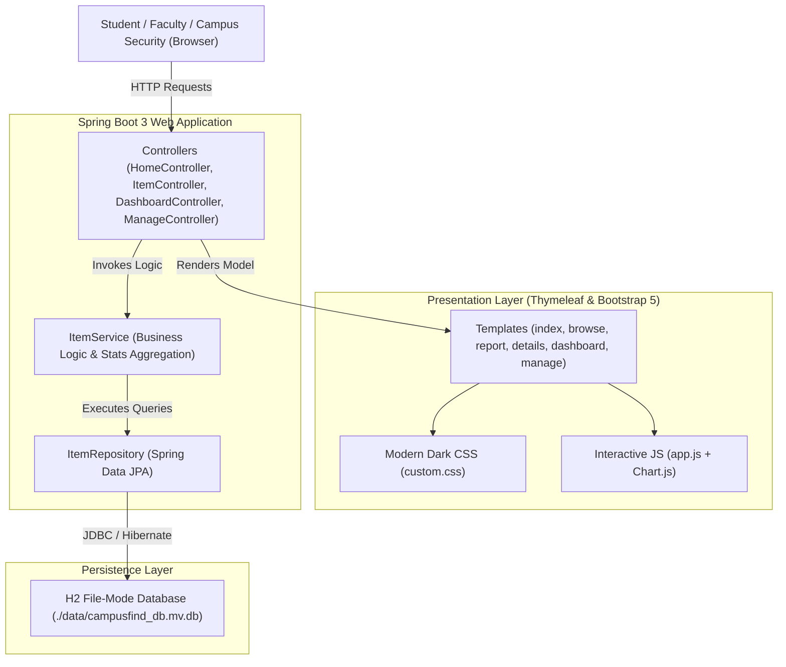
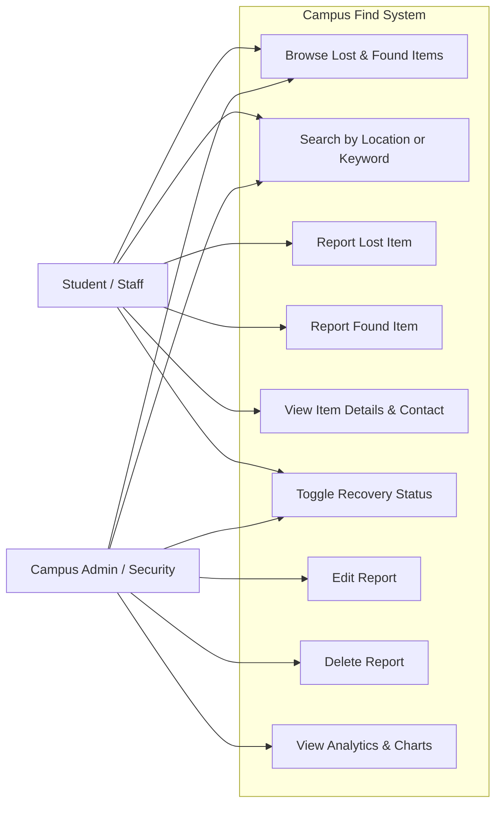
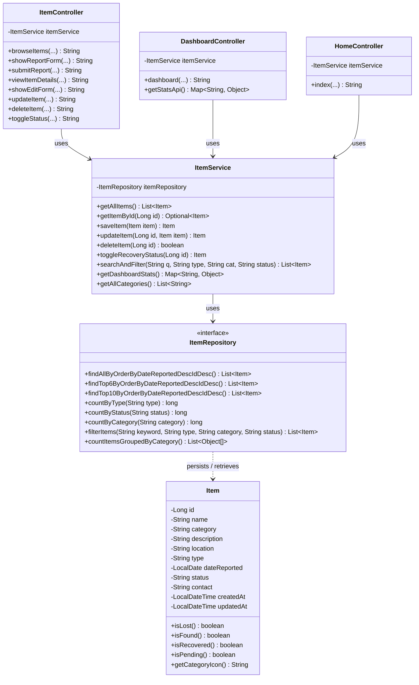
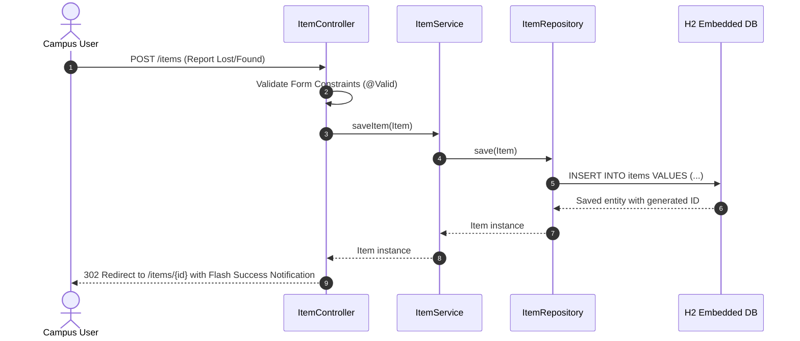

# 🎓 Campus Find – Smart Campus Lost & Found Management System

A modern, responsive full-stack university web application engineered to streamline the recording, cataloging, tracking, and recovery of misplaced belongings across campus facilities.

[](https://adoptium.net/)
[](https://spring.io/projects/spring-boot)
[](https://www.thymeleaf.org/)
[](https://h2database.com/)
[](https://getbootstrap.com/)

---

## 📋 Table of Contents
1. [Project Abstract](#-project-abstract)
2. [Problem Statement](#-problem-statement)
3. [Objectives](#-objectives)
4. [System Architecture](#-system-architecture)
5. [UML Diagrams](#-uml-diagrams)
   - [Use Case Diagram](#use-case-diagram)
   - [Class Diagram](#class-diagram)
   - [Architecture & Layered Flow Diagram](#architecture--layered-flow-diagram)
6. [Key Features](#-key-features)
7. [Database Schema & Persistence](#-database-schema--persistence)
8. [Project Structure](#-project-structure)
9. [Installation & Execution Guide](#-installation--execution-guide)
10. [Future Scope](#-future-scope)

---

## 📄 Project Abstract

Every academic semester, thousands of valuable personal items—including laptops, student identification cards, textbooks, laboratory equipment, keys, and accessories—are misplaced across university lecture halls, dining areas, study lounges, and sports complexes. Traditional recovery methods rely on fragmented physical lost-and-found boxes, cluttered campus bulletin boards, or unmoderated social media threads.

**Campus Find** addresses this inefficiency through an enterprise-grade, web-based centralized management platform built on **Java 17, Spring Boot 3, Spring Data JPA, Thymeleaf, and persistent H2 file storage**. It provides an intuitive, high-contrast, modern UI/UX design (Navy/Charcoal background with Electric Blue, Emerald Green, and Crimson accents), multi-parameter search and dynamic categorization, real-time dashboard analytics, recovery status transitions, and administrative auditing. The platform ensures zero-configuration local execution, robust data persistence across server restarts, and strict data validation.

---

## ⚠️ Problem Statement

University campuses span vast physical areas where students and faculty transit rapidly between buildings. When an item is lost:
1. **Information Asymmetry**: The person who found the item often has no convenient way to notify the rightful owner.
2. **Fragmentation**: Multiple departments (Library, Security, Student Union, Athletic Center) maintain disconnected lost collections.
3. **Lack of Tracking & Auditing**: Campus administration cannot monitor resolution rates or identify repeat lost-property hotspots.
4. **Security Vulnerabilities**: Claiming items without verifiable details or designated handover guidelines leads to disputes or fraudulent claims.

---

## 🎯 Objectives

- **Centralized Registry**: Deliver a single campus-wide portal for lost and found reports.
- **Instant Search & Multi-criteria Filtering**: Allow searching by keyword, campus location, category, item type (LOST/FOUND), and status (PENDING/RECOVERED).
- **Persistent Data Store**: Implement file-backed H2 embedded storage to preserve reports across restarts without requiring MySQL or external database setup.
- **Analytics Dashboard**: Offer visual insights into recovery percentages, status distribution, and category trends via interactive Chart.js graphs.
- **Responsive Startup UI**: Build a modern, mobile-friendly interface designed with high-contrast university aesthetics.

---

## 🏛️ System Architecture

Campus Find implements the standard **Model-View-Controller (MVC)** architectural pattern:



---

## 📐 UML Diagrams

### Use Case Diagram



### Class Diagram



### Architecture & Layered Flow Diagram



---

## ✨ Key Features

1. **Homepage & Central Hub**:
   - High-impact hero section with immediate quick-search functionality.
   - Distinctive "Report Lost Item" (Crimson) and "Report Found Item" (Emerald) action buttons.
   - Real-time statistics counters (Total Reports, Active Searches, Recovered Items, Recovery Rate).
   - "How It Works" 3-step walkthrough and recent campus reports preview.

2. **Browse & Multi-Filter Catalog**:
   - Instant search across item names, campus buildings, and detailed descriptions.
   - Filter by report type (`ALL`, `LOST`, `FOUND`).
   - Filter by category (`Electronics`, `Documents`, `Accessories`, `Books`, `Clothing`, `Personal belongings`, `Other`).
   - Filter by resolution status (`ALL`, `PENDING`, `RECOVERED`).
   - Dynamic category placeholders and badge highlights.

3. **Item Reporting with Validation**:
   - Clean radio/card toggle for LOST vs. FOUND.
   - Server-side Spring Validation (`@NotBlank`, `@Size`, `@NotNull`).
   - Helpful guidance on serial numbers, distinguishing marks, and official campus pickup desks.

4. **Detailed Item View**:
   - Comprehensive description, tracking code (`#CF-{id}`), facility location, and date logged.
   - Direct contact card with secure claiming instructions.
   - Quick one-click "Mark as Recovered" toggle.
   - Print report slip support.

5. **Analytics & Metrics Dashboard**:
   - Real-time resolution percentage progress indicator.
   - Interactive Doughnut Chart: Distribution of Lost vs. Found vs. Recovered.
   - Interactive Bar Chart: Breakdown of reports by item category.
   - 10 most recent activity feed entries.

6. **Demonstration Administrative Portal (`/manage`)**:
   - Full tabular overview of all database records.
   - Quick search and filtering inside the management view.
   - One-click recovery status switch.
   - Direct edit and delete operations with confirmation dialogs.
   - Link to embedded H2 Web Console (`/h2-console`).

7. **Database Persistence & Automatic Seeding**:
   - Configured with file-mode H2 (`./data/campusfind_db`).
   - Automatic seeding on first launch with 12 diverse, realistic campus records.
   - Idempotent: Subsequent restarts preserve all user edits, additions, and deletions without re-inserting duplicates.

---

## 🗄️ Database Schema & Persistence

Entity: `Item` (Table: `items`)

| Column Name | Data Type | Constraints | Description |
|---|---|---|---|
| `id` | `BIGINT` | PRIMARY KEY, AUTO_INCREMENT | Unique tracking identifier |
| `name` | `VARCHAR(120)` | NOT NULL | Item name/title |
| `category` | `VARCHAR(50)` | NOT NULL | Standard campus category |
| `description` | `VARCHAR(2000)` | NOT NULL | Identifying features and marks |
| `location` | `VARCHAR(150)` | NOT NULL | Campus hall, room, or zone |
| `type` | `VARCHAR(20)` | NOT NULL | `LOST` or `FOUND` |
| `date_reported` | `DATE` | NOT NULL | Date lost or discovered |
| `status` | `VARCHAR(20)` | NOT NULL | `PENDING` or `RECOVERED` |
| `contact` | `VARCHAR(200)` | NULLABLE | Student email, phone, or office |
| `created_at` | `TIMESTAMP` | NOT NULL | Record creation timestamp |
| `updated_at` | `TIMESTAMP` | NOT NULL | Last modification timestamp |

Database File Location: `./data/campusfind_db.mv.db`

---

## 📁 Project Structure

```
c:\Users\A T\Desktop\CLF\
├── pom.xml                                   # Maven dependencies and build configuration
├── mvn.cmd / mvnw.cmd                        # Maven wrapper executable scripts
├── data/
│   └── campusfind_db.mv.db                   # Persistent H2 file-based database
├── src/
│   ├── main/
│   │   ├── java/com/campusfind/
│   │   │   ├── CampusFindApplication.java    # Spring Boot application entry point
│   │   │   ├── config/
│   │   │   │   └── DataInitializer.java      # Seeder for realistic initial campus data
│   │   │   ├── controller/
│   │   │   │   ├── HomeController.java       # Landing page controller
│   │   │   │   ├── ItemController.java       # Browse, report, view, edit, delete, toggle
│   │   │   │   ├── DashboardController.java  # Analytics and statistics API controller
│   │   │   │   └── ManageController.java     # Admin management portal controller
│   │   │   ├── model/
│   │   │   │   └── Item.java                 # JPA Entity with validation annotations
│   │   │   ├── repository/
│   │   │   │   └── ItemRepository.java       # Spring Data JPA repository & JPQL queries
│   │   │   └── service/
│   │   │       └── ItemService.java          # Core business logic and metrics computation
│   │   └── resources/
│   │       ├── application.properties        # H2, JPA, and Thymeleaf configuration
│   │       ├── static/
│   │       │   ├── css/
│   │       │   │   └── custom.css            # Dark Navy & Charcoal custom styles
│   │       │   └── js/
│   │       │       └── app.js                # Form toggles, confirmations, Chart.js logic
│   │       └── templates/
│   │           ├── fragments/
│   │           │   └── layout.html           # Reusable header, navbar, alerts, footer
│   │           ├── index.html                # Landing page
│   │           ├── browse.html               # Item catalog with filters
│   │           ├── report.html               # Lost/Found submission form
│   │           ├── details.html              # Item details & recovery action
│   │           ├── dashboard.html            # Analytics & visual charts
│   │           ├── manage.html               # Admin table view
│   │           ├── edit.html                 # Edit report form
│   │           └── error.html                # 404/500 custom error view
│   └── test/
│       └── java/com/campusfind/
│           └── CampusFindApplicationTests.java # Unit & integration test suite
└── README.md
```

---

## 🚀 Installation & Execution Guide

### Prerequisites
- **Java 17 or newer** (Installed at `C:\Program Files\Eclipse Adoptium\jdk-17.0.20.101-hotspot`)
- **Maven 3.8+** (Provided via `mvn.cmd` in project root or `C:\tools\apache-maven-3.9.9`)

### Running the Application

1. Open a terminal or PowerShell inside the project directory:
   ```powershell
   cd "c:\Users\A T\Desktop\CLF"
   ```

2. Run the application using Maven:
   ```powershell
   .\mvn.cmd spring-boot:run
   ```
   *Or if running from an existing packaged jar:*
   ```powershell
   java -jar target/campus-find-1.0.0.jar
   ```

3. Open your web browser and navigate to:
   **[http://localhost:8080](http://localhost:8080)**

### Accessing the Embedded H2 Database Console
- URL: **[http://localhost:8080/h2-console](http://localhost:8080/h2-console)**
- JDBC URL: `jdbc:h2:file:./data/campusfind_db`
- User Name: `sa`
- Password: *(leave blank)*

---

## 🔮 Future Scope

1. **Automated AI Visual Matching**: Integration with machine learning models to compare photos of lost and found items and suggest match probabilities.
2. **University Single Sign-On (SSO)**: Integration with OAuth2 / SAML / CAS using institutional student email accounts.
3. **SMS & Email Push Notifications**: Automated notifications to reporters when a matching category or location report is filed.
4. **Interactive Campus Map**: Visual geospatial map showing item lost/found density across buildings.
5. **QR Code Verification**: Instant generation of secure claim tokens to present at campus security collection hubs.
